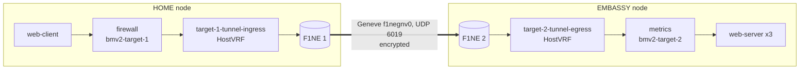

# Remote Embassy: service chaining with hardware encryption (SC26 demo)

This example shows how an organization can extend its network services into a partner's facility and
keep control over them. One Kubernetes cluster spans two sites: the **HOME** organization and its
**EMBASSY** inside the partner's facility. A web client at HOME fetches a page from a web server at the
EMBASSY. Loom steers that traffic with SRv6 through a chain of network functions:

- a **firewall** at HOME that only lets client-to-server traffic through,
- an **encrypted inter-site hop** across two Fortaegis 1 Network Encryptor (F1NE) devices,
- a **metrics** function at the EMBASSY that counts the bytes it receives.

Neither application changes. The client sends plain HTTP to a plain service name, and the chain is
deployed from declarative Kubernetes resources.

The F1NE devices each contain a hardware security module whose identity comes from a physically
unclonable function (PUF). The devices authenticate each other on that basis and encrypt the selected
inter-site traffic. The [Fortaegis1 plugin for Loom](https://uva-hva.gitlab.host/mantra6g/fortaegis1-plugin)
exposes the devices to Loom as ordinary NetworkFunctions, so a ServiceChain can use them like any
other function.

## Topology



## What's in this directory

| File                                         | Contents                                                                                                   |
|----------------------------------------------|------------------------------------------------------------------------------------------------------------|
| [demo.yml](demo.yml)                         | The applications, the two BMv2 targets, the `firewall` and `metrics` NetworkFunctions and the ServiceChain. |
| [targets.yml](targets.yml)                   | One `Fortaegis1Target` per F1NE device. The plugin turns these into the tunnel NetworkFunctions.            |
| [config.yml](config.yml)                     | The firewall's `NetworkFunctionConfig`. The firewall controller fills it in.                                |
| [controller.yml](controller.yml)             | The firewall controller Deployment and its RBAC.                                                            |
| [firewall/firewall.p4](firewall/firewall.p4) | P4 program of the firewall.                                                                                 |
| [firewall/controller/](firewall/controller/) | Source of the firewall controller.                                                                          |
| [metrics/metrics.p4](metrics/metrics.p4)     | P4 program of the metrics function.                                                                         |
| [Makefile](Makefile)                         | Builds and pushes the firewall controller image.                                                            |

## How it works

### Loom resources

[demo.yml](demo.yml) declares the whole service:

- **Applications** `web-client` and `web-server`. Their pods join Loom's network through the
  `loom-cni` network annotation. The `web-server` pods use anti-affinity to stay off the client's node,
  so client and server always run on different sites.
- **BMv2Targets** `bmv2-target-1` and `bmv2-target-2`. These are software P4 switches. Pod affinity
  places them next to `web-client` (HOME) and `web-server` (EMBASSY).
- **NetworkFunctions** `firewall` and `metrics`. Each one names a P4 program (`p4File`) and selects a
  target with `p4target.loom.io/arch: v1model`. The plugin's targets have architecture `fortaegis1`, so
  these functions always land on the BMv2 targets.
- **ServiceChain** `client-server-with-firewall`. It lists the functions in order:
  `firewall` → `tunnel-ingress` (of `target-1`) → `tunnel-egress` (of `target-2`) → `metrics`.
  Loom gives every function an SRv6 SID, and turns the chain into a segment list. Traffic from the
  client to the server is encapsulated with that list and visits each function in turn.
- **Service** `web-server`. Loom's DNS makes it reachable as `web-server.default.svc.loom.local`.

### Firewall

[firewall.p4](firewall/firewall.p4) applies the SRv6 `End` behaviour and only lets permitted traffic through.
It parses the inner IPv4 or IPv6 header under the SRH. A packet passes only if its inner source address
hits a `fw_src_*` table **and** its inner destination address hits the matching `fw_dst_*` table. The
function drops non-SRv6 packets, malformed segment lists and everything else.

You don't fill these tables by hand. The firewall controller
([controller.yml](controller.yml), [source](firewall/controller/reconcilers/firewall_reconciler.go))
watches the `web-client` and `web-server` Applications. It writes their `status.subnets` into the
`firewall-config` NetworkFunctionConfig ([config.yml](config.yml)), and Loom programs the switch from that
config. When the subnets change, the controller updates the tables. When someone edits the config by hand,
the controller restores it.

### Metrics

[metrics.p4](metrics/metrics.p4) applies the SRv6 `End` behaviour and counts every byte it receives in the
`bytes_in` counter.

### The Fortaegis1 plugin

The plugin provides the encrypted hop. Its source is at
[fortaegis1-plugin](https://uva-hva.gitlab.host/mantra6g/fortaegis1-plugin). For each `Fortaegis1Target`
in [targets.yml](targets.yml), it does the following.

**The operator** runs two controllers:

- The *encryption controller* puts the `deviceID` of every target into the Fabrik group `loom-managed`.
  Fabrik is the F1NE management backend. For every ordered pair of devices, the controller creates an
  `Encrypt` policy (FESKE-Lite, UDP to port 6019). Each direction has its own policy.
- The *driver controller* runs one driver Deployment per target. Each Deployment is pinned to the target's
  `nodeName` and uses the host network. The driver's readiness becomes the target's `Ready` condition.

**The driver**, one per node, sets up the node's side of the tunnel:

1. It creates a `P4Target` named after the target, with `spec.attachment.type: HostVRF`. Loom allocates the
   target's SID range (`spec.nfCIDR`) and creates a VRF for it on the host.
2. It creates two NetworkFunctions on that target in the `default` namespace:

   | NetworkFunction           | SID           | Behaviour                                                              |
   |---------------------------|---------------|------------------------------------------------------------------------|
   | `<target>-tunnel-ingress` | `<nfCIDR>::1` | `End`, then routes the packet to the next SID's node over the tunnel.  |
   | `<target>-tunnel-egress`  | `<nfCIDR>::2` | `End`, then returns the packet to Loom's normal routing.               |

   Both functions carry these labels, which the ServiceChain selects on:

   | Label                                   | Value                               |
   |-----------------------------------------|-------------------------------------|
   | `fortaegis1.plugins.loom.io/function`   | `tunnel-ingress` or `tunnel-egress` |
   | `fortaegis1target.plugins.loom.io/name` | name of the `Fortaegis1Target`      |
   | `fortaegis1.plugins.loom.io/node`       | node of the `Fortaegis1Target`      |

3. It programs the VRF. It adds the Geneve interface `f1negnv0` (UDP 6019) and the two `seg6local End`
   routes, and for each remote F1NE node it adds a route to that node's SID range through `f1negnv0`.
   The driver also renews the target's heartbeat Lease, and repeats this setup every 30 seconds.

Loom's own inter-node tunnel uses UDP 6018, and the plugin's tunnel uses UDP 6019. The F1NE policies only
match UDP 6019, so the devices encrypt only the traffic that a ServiceChain sends through the plugin's
tunnel. All other traffic between the nodes is left alone.

> **Note:** the ingress function only sends traffic into the tunnel when the next SID is the egress
> function of **another** F1NE node. If the next SID is anything else, the packet is not encrypted.
> Keep `tunnel-ingress` and `tunnel-egress` as consecutive stages in the chain.

### One request, hop by hop

1. `web-client` sends an HTTP request to `web-server.default.svc.loom.local`.
2. Loom encapsulates the request in SRv6 with the chain's segment list and sends it to `firewall` on
   `bmv2-target-1`. The firewall checks the inner addresses against its tables and forwards the packet.
3. `target-1-tunnel-ingress` (HOME VRF) sends the packet into `f1negnv0` toward the EMBASSY node.
4. The packet leaves on UDP 6019. F1NE 1 encrypts it and F1NE 2 decrypts it.
5. `target-2-tunnel-egress` (EMBASSY VRF) hands the packet back to Loom's routing.
6. `metrics` on `bmv2-target-2` counts the packet's bytes and forwards it.
7. Loom decapsulates the packet and delivers it to a `web-server` pod.

## Prerequisites

- A Kubernetes cluster with two nodes, one per site, each with an F1NE device attached.
- Loom's dependencies (Multus CNI, Flannel and cert-manager). See the
  [installation guide](../../docs/getting-started/installation.md).
- Both F1NE devices registered as assets in Fabrik. Their asset IDs go into `targets.yml`.
- The Fabrik URL and credentials, and its CA certificate if Fabrik uses a private CA.
- Credentials for the plugin's private image registry (`uva-hva.gitlab.host:4567`).
- `kubectl` and `helm`.

## Running the example

All paths are relative to the root of this repository.

### 1. Install Loom

The plugin needs HostVRF support for P4Targets, so use iml `v1.0.0-alpha.15` or later.

```bash
helm install iml oci://ghcr.io/mantra6g/iml/charts/iml \
  --version 1.0.0-alpha.15 \
  --namespace loom-system --create-namespace
kubectl get pods -n loom-system   # wait until the controller is Running
```

### 2. Install the Fortaegis1 plugin

Write the plugin settings to a values file, for example `f1plugin-values.yaml`:

```yaml
fortaegis:
  config:
    fabrikAddress: https://fabrik.example.org
    # Only if Fabrik uses a certificate from a private CA:
    # fabrikCACert: |
    #   -----BEGIN CERTIFICATE-----
    #   ...
  secrets:
    fabrikUsername: <user>
    fabrikPassword: <password>
manager:
  imageCredentials:
    registry: uva-hva.gitlab.host:4567
    username: <registry user>
    password: <registry token>
  # Only if the Fabrik host name does not resolve through the cluster DNS:
  # hostAliases:
  #   - ip: 192.0.2.10
  #     hostnames: [fabrik.example.org]
```

Then install the chart:

```bash
helm install iml-fortaegis1-plugin \
  oci://uva-hva.gitlab.host:4567/mantra6g/fortaegis1-plugin/charts/iml-fortaegis1-plugin \
  --version 0.3.1 \
  --namespace fortaegis1-system --create-namespace \
  -f f1plugin-values.yaml
kubectl get pods -n fortaegis1-system   # wait until the operator is Running
```

See the plugin's README for all chart values.

### 3. Point the targets at your nodes

```bash
kubectl get nodes -o wide
```

Edit [targets.yml](targets.yml). Set `target-1` to the HOME node and `target-2` to the EMBASSY node, and
make sure each `deviceID` is the Fabrik asset ID of the F1NE device on that node. `web-client` runs on the
HOME node, so the chain's `tunnel-ingress` (`target-1`) must be on the same node as the client.

### 4. Deploy the service

```bash
kubectl apply -f examples/demo_sc
kubectl get pods -n loom-system -w
```

Loom creates the BMv2 switches, loads the P4 programs and programs the SRv6 steering. The plugin starts
one driver per target, and the drivers create the tunnel functions. Check that everything is ready:

```bash
kubectl get fortaegis1targets        # both Ready
kubectl get p4targets                # bmv2-target-1/2 and target-1/2
kubectl get networkfunctions         # firewall, metrics and the four tunnel functions
kubectl get servicechains
```

In Fabrik, the `loom-managed` group now contains both devices, and there are two encryption policies
between them, one per direction.

### 5. Send traffic

```bash
kubectl exec deploy/web-client -- wget -qO- web-server.default.svc.loom.local
```

This returns the nginx welcome page. To watch packets pass through the functions, follow the switch logs
at HOME and at the EMBASSY in two other terminals:

```bash
kubectl logs -f -n loom-system -l bmv2target.loom.io/name=bmv2-target-1 -c bmv2-switch   # HOME: firewall
kubectl logs -f -n loom-system -l bmv2target.loom.io/name=bmv2-target-2 -c bmv2-switch   # EMBASSY: metrics
```

These commands use label selectors, so you can type them before the pods exist.

## Troubleshooting

- **A `Fortaegis1Target` is not Ready.** Check its driver pod in `fortaegis1-system` and the operator logs.
  The usual causes are a wrong `nodeName`, missing pull credentials and Fabrik connection errors.
- **The ServiceChain does not resolve.** Check that `kubectl get networkfunctions -l
  fortaegis1.plugins.loom.io/function` lists `target-1-tunnel-ingress` and `target-2-tunnel-egress`.
  Their names must match the targets named in [demo.yml](demo.yml).
- **The request hangs or is dropped at the firewall.** Check that the controller has filled in
  `kubectl get networkfunctionconfig firewall-config -o yaml`.
- **Traffic is not encrypted.** Check that `tunnel-ingress` and `tunnel-egress` are consecutive stages
  in the chain and on different nodes.

## Cleanup

```bash
kubectl delete -f examples/demo_sc
kubectl get pods -n loom-system -l bmv2target.loom.io/name   # must be empty before you redeploy
helm uninstall iml-fortaegis1-plugin -n fortaegis1-system
helm uninstall iml -n loom-system
```

Leftover BMv2 targets prevent the next deployment from working, so wait until the second command returns
no pods. Deleting the `Fortaegis1Target`s removes their drivers, tunnel functions and P4Targets. It also
removes the devices from the Fabrik group and deletes their policies.

## Rebuilding the firewall controller

```bash
cd examples/demo_sc
make docker-build docker-push   # ghcr.io/mantra6g/examples/firewall-controller:0.0.1
make kind-load                  # optional: load the image into a local kind cluster
```

Override `IMG_FW_CONTROLLER` to use a different image tag.

## Credits

Loom is joint work of the University of Amsterdam, Ericsson Research and ELTE, within the Dutch 6G Future
Network Services programme. The F1NE devices are made by Fortaegis.
