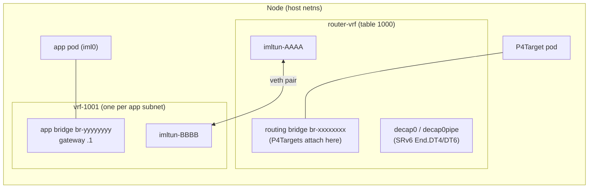

# Daemon dataplane: missing teardown and non-idempotent state

| | |
|---|---|
| **Area** | `daemon/` — VRF dataplane (`daemon/pkg/dataplane/vrf`), CNI server (`daemon/cni`), ServiceChain/P4Target daemon controllers. Related: operator CIDR allocator (§5 D1) |
| **Severity** | High — user-visible breakage on re-apply, resource exhaustion after a bounded number of pod/app lifecycles, possible daemon crash |
| **Status** | Open. Not fixed; documented 2026-10-30 at commit `7b610e2` |
| **Line numbers** | Refer to commit `7b610e2`. Re-check them if the files have changed since. |

## 1. Summary

The daemon dataplane is effectively **create-only**:

- The `Dataplane` interface does have teardown methods (`DeleteAppInstance`, `DeleteP4TargetInstance`, `RemoveP4TargetRoutes`, `RemoveAppRoutes`). In the VRF implementation they are all **no-ops**, or **never called**.
- Per-app and per-target state is cached in memory under the object's **name**, not its UID. A deleted object that is recreated under the same name inherits stale state.
- None of the allocators (subnet prefixes, tunnel prefixes, VRF tables, pod IPs) can **release** anything. Each one only moves a "last allocated" cursor forward.
- ServiceChain route bookkeeping **appends on every reconcile** and is never diffed against the routes that should exist.

Consequences, from most to least visible:

1. **Re-applying a deleted set of manifests breaks service chains.** This is how the problem was found; see [§3](#3-case-study-demo_sc-delete-and-re-apply).
2. **Pods stop starting** after about 13 (re)starts of the same Application on a node, because the app's /28 runs out of IPs (A10).
3. **App subnets run out** after 16 distinct app subnets per node per daemon lifetime with the default IPv4 pool (A7).
4. **Kernel and iptables state leaks** with every app lifecycle: links, routes, CT-zone rules.
5. **The daemon can crash** on an unsynchronized map access (C3). After a crash it can't create its first app subnet again (A2).

Everything is cleaned up only when the daemon **shuts down gracefully** (`Software.Shutdown`, registered with the janitor at [`daemon/cmd/daemon/main.go:99`](../daemon/cmd/daemon/main.go#L99)).

## 2. Background: what the daemon creates

When the first pod of an Application lands on a node, the CNI plugin calls the daemon at `POST /api/v1/cni/app/register`. The daemon then runs `Software.ConfigureAppInstance` → `addApplicationSubnet`, which creates the resources below.



For each **app subnet** (one per Application per node, in practice), the daemon creates:

| Kind | What | Where created |
|---|---|---|
| Prefixes | One IPv4 /28 + one IPv6 /96 from the node's pod CIDR | [`software_linux.go:583-590`](../daemon/pkg/dataplane/vrf/software_linux.go#L583-L590) |
| Table ID | VRF table ID (1001, 1002, …) | [`software_linux.go:594`](../daemon/pkg/dataplane/vrf/software_linux.go#L594) |
| Links | VRF link `vrf-<table>` | [`appsubnet.go:76`](../daemon/pkg/dataplane/vrf/appsubnet.go#L76) |
| Links | Bridge `br-<8 hex>` with the gateway IPs | [`appsubnet.go:104`](../daemon/pkg/dataplane/vrf/appsubnet.go#L104) |
| Links | veth pair `imltun-<4 hex>` ↔ `imltun-<4 hex>`, one end in `router-vrf`, the other in the app VRF | [`software_linux.go:666`](../daemon/pkg/dataplane/vrf/software_linux.go#L666) |
| Prefixes | One IPv4 /30 + one IPv6 /126 from the node's tunnel CIDR, for that veth pair | [`software_linux.go:678`](../daemon/pkg/dataplane/vrf/software_linux.go#L678), [`:699`](../daemon/pkg/dataplane/vrf/software_linux.go#L699) |
| Routes | Route in `router-vrf`: app prefixes → veth | [`software_linux.go:638`](../daemon/pkg/dataplane/vrf/software_linux.go#L638) |
| Routes | Default route in the app VRF → `router-vrf` | [`software_linux.go:643`](../daemon/pkg/dataplane/vrf/software_linux.go#L643) |
| iptables | 3 rules in `raw/IML-CT-ZONES` (IPv6, plus IPv4 when dual-stack) that put traffic entering each VRF into that VRF's conntrack zone: app bridge, app-side veth, router-side veth | [`software_linux.go:626`](../daemon/pkg/dataplane/vrf/software_linux.go#L626), [`:759-766`](../daemon/pkg/dataplane/vrf/software_linux.go#L759-L766) |
| API status | An entry appended to `Application.status.subnets[<nodeName>]` | [`software_linux.go:653`](../daemon/pkg/dataplane/vrf/software_linux.go#L653), [`:815`](../daemon/pkg/dataplane/vrf/software_linux.go#L815) |
| In memory | An entry in `Software.appSubnets[<namespace/name>]` | [`software_linux.go:647-652`](../daemon/pkg/dataplane/vrf/software_linux.go#L647-L652) |

**Every pod** of that app then gets one IPv4 and one IPv6 address from the subnet's own allocators ([`appsubnet.go:160`](../daemon/pkg/dataplane/vrf/appsubnet.go#L160)).

**Every P4Target pod** gets:

- an IPv6 address on the routing bridge, recorded in `Software.p4Targets[<name>]` ([`software_linux.go:900-914`](../daemon/pkg/dataplane/vrf/software_linux.go#L900-L914));
- once the target is scheduled, a route in `router-vrf` sending the target's `spec.nfCIDR` to that address ([`software_linux.go:960`](../daemon/pkg/dataplane/vrf/software_linux.go#L960)).

**Every ServiceChain** whose source app has a local subnet gets SRv6 encap routes in the source app's VRF, one per destination subnet. They are recorded in `Software.serviceChainRoutes[<chain>]` ([`software_linux.go:510`](../daemon/pkg/dataplane/vrf/software_linux.go#L510)).

The ServiceChain controller decides whether to compute routes **solely from `Application.status.subnets`**:

- If the source app has no entry for this node, it stops ([`servicechain_controller.go:97-101`](../daemon/controllers/servicechain/servicechain_controller.go#L97-L101)).
- If the destination app has no subnets anywhere, it stops ([`:114-117`](../daemon/controllers/servicechain/servicechain_controller.go#L114-L117)).

So the status field is load-bearing.

## 3. Case study: `demo_sc` delete and re-apply

Reproduction:

```sh
kubectl apply  -f examples/demo_sc   # chain works
kubectl delete -f examples/demo_sc   # wait until pods are gone
kubectl apply  -f examples/demo_sc   # chain never works again
```

What the daemon logs show:

- **First apply.** The node registers `web-server` and logs `Adding application subnet` and `Created tunnels between routing subnet and application subnet`. The P4Target gets `Allocated IPs for P4Target … fd00:0:0:1::2`, and a route for its NF CIDR `fd00:0:0:3::/80` is added.
- **Delete.** The CNI DEL path logs `received app instance teardown request` / `received p4target teardown request`. The daemon does **nothing** with them. The ServiceChain controller deletes its SRv6 routes.
- **Second apply.** The node logs `received app instance registration request` three times, but **never** `Adding application subnet`, and never `Allocated IPs for P4Target`. From then on, every ServiceChain reconcile logs `source application does not have a local subnet. Omitting route calculation`.

Step by step:

1. `kubectl delete` removes the Applications. `DeleteAppInstance` is a no-op ([`software_linux.go:879`](../daemon/pkg/dataplane/vrf/software_linux.go#L879)), so `appSubnets["default/web-server"]` (and the others) stay in memory. Their VRF, bridge and veth stay on the host.
2. `kubectl apply` creates **new** Application objects (new UID, empty `status`).
3. A pod of the new Application asks for an address. `ConfigureAppInstance` looks up `appSubnets[<namespace/name>]` ([`software_linux.go:845`](../daemon/pkg/dataplane/vrf/software_linux.go#L845)) and finds the stale subnet. `HasIPsAvailable` always returns `true`, so the subnet is reused and `addApplicationSubnet` is skipped.
4. `addApplicationSubnet` is the **only** caller of `addSubnetToAppStatus`. The new Application's `status.subnets` therefore stays empty on every node.
5. The pod itself has working connectivity, because the old bridge is still up. But the ServiceChain controller sees no local source subnet (and no destination subnets), so it **never computes or installs SRv6 routes**. Traffic doesn't go through the chain.

The same logs also show B3: after the second apply, `fd00:0:0:5::/80` is routed via `fd00:0:0:1::2`, and the old `fd00:0:0:3::/80` route from the first run is still there.

## 4. Root causes

These cross-cutting problems explain all the individual issues in §5:

1. **No deletion signal reaches the dataplane.**
   - `DeleteAppInstance`, `DeleteP4TargetInstance` and `RemoveP4TargetRoutes` are no-ops ([`software_linux.go:879`, `:926`, `:967`](../daemon/pkg/dataplane/vrf/software_linux.go#L879)).
   - `UpdateAppRoutes` / `RemoveAppRoutes` exist on the interface ([`interface.go:49-50`](../daemon/pkg/dataplane/interface.go#L49-L50)) but nothing calls them, and the daemon has no Application controller.
2. **State is keyed by name, not identity.** `appSubnets` uses `namespace/name` and `p4Targets` uses `name`. A delete followed by a create with the same name is indistinguishable from "the same object, still alive".
3. **No per-instance bookkeeping.** `ConfigureAppInstance` and `ConfigureP4TargetInstance` receive the container ID but ignore it (`_ string`). Nothing maps containerID → (app, subnet, IPs), so even a real `DeleteAppInstance(containerID)` wouldn't know what to free.
4. **Forward-only allocators.** `Subnet4Allocator`, `Subnet6Allocator`, `IPv4Allocator`, `IPv6Allocator` and `TableAllocator` ([`alloc.go`](../daemon/pkg/dataplane/alloc.go)) only remember the last value handed out. They have no `Release` and no free list.
5. **Reconcile is additive, not declarative.** ServiceChain routes are appended on every reconcile and never diffed against what should be installed.
6. **Shared maps without consistent locking.** The CNI HTTP handlers write `appSubnets` under `appMu`. The ServiceChain controller reads it, and reads and writes `serviceChainRoutes`, with no lock.

## 5. Issue catalogue

Severity scale:

- **S1**: breaks functionality or crashes the daemon.
- **S2**: guaranteed exhaustion or failure after a bounded number of operations.
- **S3**: leak or hygiene issue with limited functional impact.

### A. Application subnets

#### A1 — `appSubnets` keyed by name and never removed (S1, root cause of §3)

- **What.** `appSubnets` is a `map[client.ObjectKey][]AppSubnet` keyed by `namespace/name` ([`software_linux.go:60`](../daemon/pkg/dataplane/vrf/software_linux.go#L60)). Entries are added at [`:647-652`](../daemon/pkg/dataplane/vrf/software_linux.go#L647-L652) and only ever cleared by `Shutdown`.
- **Observe.**

  ```sh
  kubectl get application <name> -o jsonpath='{.status.subnets}'
  ```

  After a delete + re-apply this prints nothing. Meanwhile `ip -br link | grep vrf-` on the node still shows the old VRF.
- **Impact.** A recreated Application silently reuses the old subnet, and its status is never filled in, so no ServiceChain that touches it ever gets routes.
- **Approach.**
  - Short term: make `addSubnetToAppStatus` idempotent (skip if the entry is already listed) and call it on the reuse path in `ConfigureAppInstance` too. This alone fixes §3.
  - Long term: key the state on the Application **UID**, or check the UID on lookup. Tear down the old subnet when the UID changes or the last instance goes away (see A2–A10 and §6).

#### A2 — App VRF links leak; deterministic names collide after a crash (S1 after a crash, S3 otherwise)

- **What.**
  - `vrf-<table>` is created at [`appsubnet.go:76`](../daemon/pkg/dataplane/vrf/appsubnet.go#L76). Its name comes from the table ID ([`vrf_util.go:73`](../daemon/pkg/dataplane/vrf/util/vrf_util.go#L73)), and table IDs start at 1000 every time the daemon starts ([`software_linux.go:141`](../daemon/pkg/dataplane/vrf/software_linux.go#L141)).
  - On startup, `cleanupStaleRoutingSubnet` ([`routingsubnet.go:210`](../daemon/pkg/dataplane/vrf/routingsubnet.go#L210)) removes only `router-vrf`, the bridges enslaved to it, and `decap0`.
- **Observe.**

  ```sh
  ip -br link show type vrf
  ```

  The list keeps growing with app lifecycles. After a daemon crash (`kill -9`, OOM, panic), the old `vrf-1001…` links are still there.
- **Impact.**
  - While the daemon runs: leaked links.
  - After an **ungraceful** restart: the first new app subnet tries to create `vrf-1001`, fails with `EEXIST`, and CNI ADD fails, so pods get stuck in `ContainerCreating`.
- **Approach.**
  - Delete the VRF when the subnet is torn down.
  - At startup, sweep `vrf-*` links whose table is in the daemon's range (≥1000), together with their enslaved bridges and `imltun*` veths, the same way `cleanupStaleRoutingSubnet` does for `router-vrf`.

#### A3 — App bridges leak (S3)

- **What.** `br-<8 hex>` is created at [`appsubnet.go:104`](../daemon/pkg/dataplane/vrf/appsubnet.go#L104) and deleted only in `AppSubnet.Teardown`, which runs only from `Shutdown` or from error paths.
- **Approach.** Covered by the subnet teardown (§6 phase 3). `AppSubnet.Teardown` already does the right thing; it just never gets called.

#### A4 — `imltun` veth pairs leak; router-side name not stored (S3)

- **What.**
  - `createSubnetToSubnetTunnels` ([`software_linux.go:666`](../daemon/pkg/dataplane/vrf/software_linux.go#L666)) creates the pair and calls `SetTunnel` on both subnets.
  - `RoutingSubnet.SetTunnel` is a no-op ([`routingsubnet.go:530`](../daemon/pkg/dataplane/vrf/routingsubnet.go#L530)), so only the **app-side** name is stored in `AppSubnet.Tunnel`.
- **Impact.** Deleting either end deletes the pair, so `AppSubnet.Teardown` is enough for the link. But the router-side name is needed to remove its CT-zone rule (A6), and it isn't stored anywhere.
- **Approach.** Store both tunnel names, and both tunnel prefix allocations (A8), on the `AppSubnet`.

#### A5 — Router-vrf route to the app prefix never removed explicitly (S3)

- **What.** `routingSubnet.AddRoute(subnet.Networks, …)` ([`software_linux.go:638`](../daemon/pkg/dataplane/vrf/software_linux.go#L638)). The kernel flushes it when the veth goes away, but the veth never goes away (A4). `RoutingSubnet.RemoveRoute` ([`routingsubnet.go:473`](../daemon/pkg/dataplane/vrf/routingsubnet.go#L473)) exists and is unused.
- **Observe.**

  ```sh
  ip route show vrf router-vrf
  ip -6 route show vrf router-vrf
  ```

  Routes to app prefixes of deleted apps are still listed.
- **Approach.** Call `RemoveRoute` explicitly in the subnet teardown, before deleting the veth, so the order doesn't depend on the kernel flushing it. Treat `ESRCH` as success.

#### A6 — CT-zone iptables rules never removed (S3, latent S1)

- **What.**
  - Three rules per app subnet per address family are added to `raw/IML-CT-ZONES` ([`software_linux.go:626`](../daemon/pkg/dataplane/vrf/software_linux.go#L626), [`:759-766`](../daemon/pkg/dataplane/vrf/software_linux.go#L759-L766)).
  - They are removed only on the `addApplicationSubnet` error path, or when `Shutdown` flushes the whole chain.
  - Deleting a link does **not** delete the iptables rules that match it by name.
- **Observe.**

  ```sh
  ip6tables -t raw -S IML-CT-ZONES
  iptables  -t raw -S IML-CT-ZONES
  ```

  Rules for interfaces that no longer exist pile up.
- **Impact.**
  - The chain keeps growing, and every packet entering any VRF is matched against it.
  - `imltun` names have only **4 hex characters** ([`software_linux.go:667`](../daemon/pkg/dataplane/vrf/software_linux.go#L667)), so 65,536 possibilities. With leaked rules, a new tunnel that happens to reuse a name gets the **stale zone** of a long-gone VRF. That breaks conntrack for that VRF in a way that is very hard to debug.
- **Approach.**
  - Remove the rules in the subnet teardown (`removeAppSubnetCTZoneRules` already exists; add the two tunnel rules).
  - Consider longer tunnel names (interface names allow up to 15 chars, so `imltun-` + 8 hex fits).

#### A7 — App prefixes never released (S2)

- **What.** `appNet4Allocator` (/28) and `appNet6Allocator` (/96) only move forward ([`alloc.go:36`, `:78`](../daemon/pkg/dataplane/alloc.go#L36)).
- **Impact.**
  - The default per-node IPv4 pool is /24 (`cluster-pool-ipv4-mask-size: "24"` in [`operator/config/configmaps/iml_configmap.yaml`](../operator/config/configmaps/iml_configmap.yaml)). That gives **16 IPv4 app subnets per daemon lifetime**.
  - Today this is partly hidden by A1, because a recreated app reuses its old subnet. **Any fix for A1 that creates a fresh subnet without releasing the old prefix makes things worse**: the demo (3 apps) would run out of IPv4 subnets after about 5 apply/delete cycles.
- **Approach.** Give the allocators a free set: return a released prefix to the pool and hand out released prefixes first. A1's long-term fix must not land without this.

#### A8 — Tunnel prefixes never released (S2)

- **What.** `tunNet4Allocator` (/30) and `tunNet6Allocator` (/126) are forward-only ([`software_linux.go:678`, `:699`](../daemon/pkg/dataplane/vrf/software_linux.go#L678)).
- **Impact.** The default per-node tunnel pool is /24, so **64 tunnels per daemon lifetime**. Same trap as A7.
- **Approach.** Same as A7. Store the allocated prefixes on the `AppSubnet` so they can be released.

#### A9 — VRF table IDs never released (S3)

- **What.** `TableAllocator.Allocate` just increments ([`alloc.go:193`](../daemon/pkg/dataplane/alloc.go#L193)).
- **Impact.** Practically unbounded (uint32), but it ties into A2's naming collisions.
- **Approach.** Either release IDs or keep them monotonic. If they stay monotonic, the startup sweep from A2 is mandatory.

#### A10 — Per-pod IPs never released; subnet "full" is never detected (S2, the most likely to hit first)

- **What.**
  - Every `ConfigureAppInstance` calls `subnet.AllocateIPs()` ([`appsubnet.go:160`](../daemon/pkg/dataplane/vrf/appsubnet.go#L160)), which moves the subnet's own IP allocators forward.
  - `DeleteAppInstance` releases nothing, and couldn't anyway: the container ID is ignored on allocation, so nothing records which IPs a container got.
  - `HasIPsAvailable` is hard-coded to `true` ([`appsubnet.go:152`](../daemon/pkg/dataplane/vrf/appsubnet.go#L152)), so a second subnet is never created for the app.
  - In dual-stack mode, IPv6 is allocated **before** IPv4. When IPv4 runs out, the IPv6 address just taken is leaked.
- **Impact.** An IPv4 /28 has 14 host addresses, minus the gateway, which leaves **about 13 pod IPs per app per node for the whole daemon lifetime**. Every pod restart, rollout, reschedule onto the same node, or demo re-apply (because of A1) uses one up. After that, **CNI ADD for that app fails on that node for good**, until the daemon restarts.
- **Observe.** Scale one Deployment up and down repeatedly on a single node, or re-apply `demo_sc` about 13 times. Pods get stuck in `ContainerCreating`, and the daemon logs `failed to allocate IPs for application`.
- **Approach.**
  - Record `containerID → {appKey, subnet, IPs}` in `ConfigureAppInstance`.
  - Release the IPs in `DeleteAppInstance`.
  - Give `IPv4Allocator`/`IPv6Allocator` a `Release`.
  - Make `HasIPsAvailable` real, so a second subnet is created when one fills up.
  - Roll back the IPv6 allocation if the IPv4 one fails.
  - CNI DEL can be retried by the kubelet, so `DeleteAppInstance` must be idempotent: an unknown container ID returns success.

#### A11 — `Application.status.subnets` never pruned (S3, S1 after a restart)

- **What.** `addSubnetToAppStatus` only appends ([`software_linux.go:828`](../daemon/pkg/dataplane/vrf/software_linux.go#L828)). Neither subnet teardown nor `Shutdown` removes the entry.
- **Impact.**
  - When an Application is deleted, its status goes with it, so that case is fine.
  - When the **daemon** restarts, though, all in-memory subnets are gone while the status still lists them. New subnets are appended next to the dead ones.
  - Peer nodes then compute SRv6 routes towards prefixes that no longer exist ([`servicechain_controller.go:180`](../daemon/controllers/servicechain/servicechain_controller.go#L180) iterates over all of them).
- **Approach.**
  - On startup (and on subnet teardown), reconcile `status.subnets[<thisNode>]` to exactly the subnets the daemon actually has.
  - Since the daemon owns its own node's key, it can overwrite that key without coordinating with other nodes.

### B. P4Targets

#### B1 — `p4Targets` entry never removed (S3)

- **What.** `p4Targets[<name>]` is set at [`software_linux.go:911`](../daemon/pkg/dataplane/vrf/software_linux.go#L911). `DeleteP4TargetInstance` is a no-op ([`:926`](../daemon/pkg/dataplane/vrf/software_linux.go#L926)).
- **Impact.** A recreated target with the same name silently gets the old IP. That's why the second run in §3 has no `Allocated IPs for P4Target`. It works by accident; renamed targets leak their entries.
- **Approach.**
  - Record the container ID on the entry.
  - Remove the entry and release the IP (B2) in `DeleteP4TargetInstance`. Make that idempotent.

#### B2 — Routing-subnet IPs never released (S3)

- **What.** `routingSubnet.AllocateIPs()` ([`software_linux.go:900`](../daemon/pkg/dataplane/vrf/software_linux.go#L900)) uses a forward-only `IPv6Allocator`.
- **Impact.** Slow leak. The /96 makes exhaustion unrealistic, but once B1 is fixed the IP for a recreated target will change, so B3 becomes more important.

#### B3 — Local NF-CIDR route never removed (S3, potential misrouting)

- **What.**
  - `UpdateP4TargetRoutes` installs `<spec.nfCIDR> via <targetIP> dev <routing bridge>` in `router-vrf` ([`software_linux.go:960`](../daemon/pkg/dataplane/vrf/software_linux.go#L960)).
  - `RemoveP4TargetRoutes` is a no-op ([`:967`](../daemon/pkg/dataplane/vrf/software_linux.go#L967)), and the installed CIDR isn't stored anywhere, so the function couldn't know what to delete even if implemented.
  - Compare the **peer-node** path in the same reconciler, which records `remoteRoutes` and removes them correctly ([`p4target_controller.go:56`, `:111-126`](../daemon/controllers/p4target/p4target_controller.go#L111-L126)).
- **Observe.** In the §3 logs, `fd00:0:0:3::/80` and `fd00:0:0:5::/80` are both routed via `fd00:0:0:1::2` after the second apply. Check with:

  ```sh
  ip -6 route show vrf router-vrf
  ```

- **Impact.** Stale routes build up. Because of B1, the stale route's gateway is now the *new* target, so traffic for an NF CIDR that no longer exists is still sent to a live switch.
- **Approach.**
  - Keep a `map[target]nfCIDR` for local routes (mirroring `remoteRoutes`).
  - Make `RemoveP4TargetRoutes` delete the route, and replace it when `spec.nfCIDR` or the target IP changes.

### C. ServiceChain route bookkeeping

#### C1 — Routes appended on every reconcile; delete then fails forever (S1 on the source node)

- **What.**
  - `AddServiceChainRoutes` appends every route to `serviceChainRoutes[chain]` unconditionally ([`software_linux.go:529`](../daemon/pkg/dataplane/vrf/software_linux.go#L529)).
  - The ServiceChain controller re-runs it on every NF/P4Target/Application/LoomNode event. The kernel side is idempotent (`RouteReplace`), but the list fills up with duplicates.
  - On chain deletion, `DeleteAllServiceChainRoutes` ([`:561`](../daemon/pkg/dataplane/vrf/software_linux.go#L561)) calls `RouteDel` once per list entry. The first call for a prefix succeeds, and the **duplicate** fails with `ESRCH` ("no such process").
  - The function returns that error **before** `delete(d.serviceChainRoutes, chain)`. The controller requeues, and the next attempt fails on the very first entry (the route is already gone). This repeats forever with backoff.
- **Observe.** On the node hosting the chain's source app, after `kubectl delete servicechain …`, the daemon logs `failed to add SRv6 route to subnet …` (the message is wrong, see C2) and the reconcile error repeats.
- **Impact.**
  - An endless reconcile error loop. The map entry is never cleared.
  - If routes were deleted partway through, any remaining distinct prefixes stay installed.
- **Approach.**
  - Store routes as a set keyed by `(sourceApp, destNet)` and replace the whole set on each reconcile.
  - In `DeleteSRv6Route`, treat `ESRCH`/`ENOENT` as success.

#### C2 — `DeleteServiceChainRoute` appends instead of removing (S3)

- **What.** After deleting a route, it does `append(d.serviceChainRoutes[chain], route)` ([`software_linux.go:557`](../daemon/pkg/dataplane/vrf/software_linux.go#L557)), and its error message says "failed to add" ([`:554`](../daemon/pkg/dataplane/vrf/software_linux.go#L554)).
- **Impact.** Wrong bookkeeping. It's masked today only because `DeleteAllServiceChainRoutes` deletes the whole key afterwards (when it gets that far, see C1).
- **Approach.** Remove the route from the set, and fix the message.

#### C3 — Unsynchronized map access, which can crash the daemon (S1)

- **What.**
  - The CNI server's HTTP handlers write `appSubnets` while holding `appMu` ([`software_linux.go:842`](../daemon/pkg/dataplane/vrf/software_linux.go#L842)).
  - `AddServiceChainRoutes`, `DeleteServiceChainRoute` and `DeleteAllServiceChainRoutes` run on the controller goroutine. They read `appSubnets` and read and write `serviceChainRoutes` **without any lock** ([`:510-574`](../daemon/pkg/dataplane/vrf/software_linux.go#L510-L574)).
- **Impact.** If a pod registers while a ServiceChain reconciles, Go's runtime can abort with `fatal error: concurrent map read and map write`. That kills the daemon without running `Shutdown`, which then triggers A2 on the next start.
- **Observe.** `go test -race` on a test that runs `ConfigureAppInstance` and `AddServiceChainRoutes` concurrently.
- **Approach.** Hold `appMu` (or a dedicated lock taken in a fixed order with `appMu`) in all ServiceChain route methods.

#### C4 — Teardown ordering between chains and subnets (design constraint)

- **What.** `DeleteServiceChainRoute` silently skips when the source app's subnet isn't in `appSubnets` ([`software_linux.go:546-549`](../daemon/pkg/dataplane/vrf/software_linux.go#L546-L549)), but it fails on a missing kernel route.
- **Impact.** Once app subnets are actually torn down (A1–A10), a chain's routes may already be gone along with the VRF before the chain is deleted. Without C1's `ESRCH` tolerance, this brings back the endless retry loop.
- **Approach.** Route deletion must be idempotent. Subnet teardown should also drop any `serviceChainRoutes` entries that point into that subnet.

#### C5 — Reconcile never removes routes that are no longer wanted (S3, potential misrouting)

- **What.**
  - `Reconcile` computes the routes it wants and calls `AddServiceChainRoutes` with them. It never compares them with the routes already installed.
  - The early returns leave previously installed routes in place: no local source subnet, no destination subnets, an empty `routes` list because a stage has no ready NF ([`servicechain_controller.go:97-152`](../daemon/controllers/servicechain/servicechain_controller.go#L97-L152)).
  - `ListServiceChainRoutes` exists on the interface but is unused.
- **Impact.** Old SRv6 routes stay installed:
  - when an NF disappears (so traffic is encapsulated to a dead SID and dropped instead of the chain reporting "not ready");
  - when a destination subnet goes away;
  - when the chain's `from`/`to` changes.
- **Approach.** Make the reconcile declarative: compute the desired set, diff it with the installed set, and add and remove accordingly, including on the early-return paths (desired = ∅).

### D. Related: operator CIDR allocation

This isn't daemon code, but it's the same kind of problem (in-memory allocation state that isn't rebuilt), and it determines what is safe when resetting a cluster.

#### D1 — Operator prefix allocator isn't rebuilt after a restart; node and NF CIDRs can collide (S1 after an operator restart)

- **What.**
  - The operator creates one in-memory `clusterCIDRv6Allocator` ([`operator/cmd/manager/main.go:227`](../operator/cmd/manager/main.go#L227)) and uses it for two things:
    - LoomNode pod CIDRs ([`loomnode_controller.go:110`](../operator/internal/controller/infra/loomnode/loomnode_controller.go#L110), wired at [`main.go:356`](../operator/cmd/manager/main.go#L356));
    - P4Target NF CIDRs ([`p4target_controller.go:101`](../operator/internal/controller/core/p4target/p4target_controller.go#L101), wired at [`main.go:300`](../operator/cmd/manager/main.go#L300)).
  - `prefixAllocator.Next` ([`operator/pkg/ipam/allocator.go:69`](../operator/pkg/ipam/allocator.go#L69)) only moves a `LastAssigned` cursor forward. It has no `Release`, and nothing reserves the CIDRs already stored on existing LoomNodes and P4Targets when the operator starts.
  - The IPv4 node-CIDR and tunnel-CIDR allocators work the same way.
- **Impact.**
  - While the operator keeps running, this is harmless: every P4Target recreation uses one more /64 out of about 2⁴⁸ in `fd00::/16`. In the §3 logs you can see `fd00:0:0:3::` and `:4::`, then `:5::` and `:6::`.
  - After **any operator restart** (crash, OOM at its 512 Mi limit, a liveness failure, its node rebooting), the cursor starts again at `fd00::/64`. The next P4Target, or the next new node, gets a CIDR that an existing LoomNode **already owns**. A P4Target's NF CIDR then overlaps a node's pod CIDR, including that node's routing subnet, which breaks routing on that node in hard-to-diagnose ways.
  - A full `helm uninstall` hides this, because it deletes the LoomNodes too. Restarting only the daemons does not.
- **Observe.**

  ```sh
  kubectl get loomnodes -o custom-columns=NODE:.metadata.name,CIDRS:.spec.nodeCIDRs
  kubectl get p4targets -o custom-columns=TARGET:.metadata.name,NFCIDR:.spec.nfCIDR
  ```

  After an operator restart followed by a new BMv2Target, one of the NF CIDRs equals a node CIDR.
- **Approach.**
  - On startup, before the controllers run, list LoomNodes and P4Targets and reserve their CIDRs in the allocators. This needs a `Reserve` and a free set, like `AddrPool` already has ([`operator/pkg/ipam/pool.go:81`](../operator/pkg/ipam/pool.go#L81)).
  - Release a P4Target's NF CIDR when the P4Target is deleted.
  - Consider separate pools for node CIDRs and NF CIDRs, so a bug in one can't hand out the other's prefixes.

### Already handled correctly

So nobody re-investigates these:

- **Pod interfaces.** CNI DEL deletes `iml0` inside the pod netns, and that also removes the host-side veth ([`cni/cmd/loom/main.go:444-483`](../cni/cmd/loom/main.go#L444-L483)).
- **Peer-node P4Target tunnel routes.** They are tracked and removed ([`p4target_controller.go:111-126`](../daemon/controllers/p4target/p4target_controller.go#L111-L126)).
- **Graceful daemon shutdown.** It tears down the routing subnet and every app subnet, and flushes the IML iptables chains ([`software_linux.go:241`](../daemon/pkg/dataplane/vrf/software_linux.go#L241)).
- **Error paths inside `addApplicationSubnet` / `createSubnetToSubnetTunnels`.** They roll back what they created, including CT rules.

## 6. Recommended approach

Each phase can be shipped on its own. Phase 1 is enough to make the `demo_sc` re-apply scenario work.

### Phase 1: stop the bleeding (small, low risk)

- **A1 short-term.**
  - Make `addSubnetToAppStatus` idempotent: if `status.subnets[node]` already has the same `IPv4Net`/`IPv6Net`, return without patching.
  - Call it from `ConfigureAppInstance` when an existing subnet is reused.
  - The ServiceChain controller already watches Applications, so the status patch re-triggers route calculation.
- **C1/C2.**
  - Store chain routes as a set keyed by `(sourceApp, destNet)`.
  - Replace the set on each add.
  - Treat `ESRCH`/`ENOENT` as success in `AppSubnet.DeleteSRv6Route`.
  - Fix the "add" error message.
- **C3.** Lock the ServiceChain route methods.

### Phase 2: per-instance bookkeeping (fixes A10, B1, B2)

- Stop ignoring `containerID`. Keep `instances map[containerID]instanceRecord{appKey/targetKey, subnet, IPs}`.
- Add a free set to the forward-only allocators in [`alloc.go`](../daemon/pkg/dataplane/alloc.go), for example a sorted set of released values that `Allocate` checks first. `daemon/pkg/ipam` (used by the operator) may already be a better base. Evaluate reusing it instead of growing a second allocator package.
- Implement `DeleteAppInstance` / `DeleteP4TargetInstance`: look up the record, release the IPs, decrement the subnet/target refcount. An unknown ID returns `nil`, because the kubelet retries CNI DEL.
- Make `HasIPsAvailable` real and roll back partial dual-stack allocations.

### Phase 3: subnet and target lifecycle (fixes A1–A9, B3, C4, C5)

- **Teardown at zero instances.** When a subnet's refcount reaches 0, run a full `teardownApplicationSubnet` that does, in order:
  1. drop the chain routes pointing into it;
  2. `routingSubnet.RemoveRoute(subnet.Networks)`;
  3. remove the CT rules (bridge, both tunnel ends);
  4. `AppSubnet.Teardown()` (bridge, veth, VRF);
  5. release the prefixes (app, tunnel), the table ID, and the status entry;
  6. remove the subnet from `appSubnets`.
- **Identity.** Key `appSubnets` by Application UID (or store the UID and compare on lookup), so that a recreated Application never inherits a subnet.
- **P4Targets.** Store the local NfCIDR per target, implement `RemoveP4TargetRoutes`, and replace the route on changes.
- **Declarative ServiceChain reconcile (C5).** Diff the desired routes with the installed ones, and apply the removals on every return path.

**Where should the deletion signal come from?** Two options, which complement each other:

| Signal | Good at | Misses |
|---|---|---|
| CNI DEL refcounting (`DeleteAppInstance`) | Pod churn, per-pod IP release, exact timing | Pods that disappear without a DEL (node crash, daemon down during DEL). The kubelet retries, but not forever. |
| Daemon-side Application/P4Target watch (implement and wire `RemoveAppRoutes`, or add a GC loop) | The object really being deleted, including while the daemon was down (seen as "absent" on resync) | Pod churn inside a live Application |

**Recommendation:** use CNI DEL for IP release and refcounts, *plus* a periodic or watch-driven garbage collection that tears down any subnet or target whose owning object (by UID) no longer exists, or that has had no instances for a grace period.

### Phase 4: crash recovery (fixes A2, A11)

- In `NewSoftware`, next to `cleanupStaleRoutingSubnet`, sweep:
  - `vrf-*` links with a table ≥ 1000, together with their enslaved bridges and `imltun*` veths;
  - leftover CT-zone rules need no extra work: `ensureRawIPTablesRulesArePresent` already flushes `IML-CT-ZONES` at startup ([`software_linux.go:343`](../daemon/pkg/dataplane/vrf/software_linux.go#L343)).
- After startup, rewrite `Application.status.subnets[<thisNode>]` for every Application to match what the daemon actually owns (empty right after startup, then filled in as pods register again).
- **D1, on the operator side:** at operator startup, reserve the CIDRs already held by existing LoomNodes and P4Targets before any controller runs.

## 7. Testing notes

- **Regression for §3.** apply → delete → apply `examples/demo_sc`, then check:
  - `status.subnets` is filled in on the new Applications;
  - the source node logs `found matching NFs`, not `does not have a local subnet`;
  - `ip route show vrf vrf-<table>` on the source node shows `encap seg6`.
- **Leak check after `kubectl delete`.** On each node, after Phase 3 everything here should be back to the pre-apply baseline:

  ```sh
  ip -br link | grep -E 'vrf-|imltun|br-'
  ip -6 route show vrf router-vrf
  ip    route show vrf router-vrf
  ip6tables -t raw -S IML-CT-ZONES
  iptables  -t raw -S IML-CT-ZONES
  kubectl get applications -A -o jsonpath='{range .items[*]}{.metadata.name}{" "}{.status.subnets}{"\n"}{end}'
  ```

- **A10 churn test.** Pin one Deployment to one node, then scale 0↔1 at least 20 times. Today this fails after about 13. It should succeed indefinitely.
- **A7/A8 cycle test.** Apply/delete `demo_sc` at least 10 times. After Phase 3 without allocator release, this fails after about 5 cycles. That makes it the guard rail for "don't ship A1's long-term fix without A7".
- **C3 race test.** Unit test that calls `ConfigureAppInstance` and `AddServiceChainRoutes` concurrently, run with `go test -race`. Needs netlink, so run it in a privileged netns, or put the map logic behind an interface that can be faked.
- **Crash test (A2).** `kill -9` the daemon container after apps are up, let the DaemonSet restart it, then deploy a new app on that node. Today this fails with `EEXIST` on `vrf-1001`.
